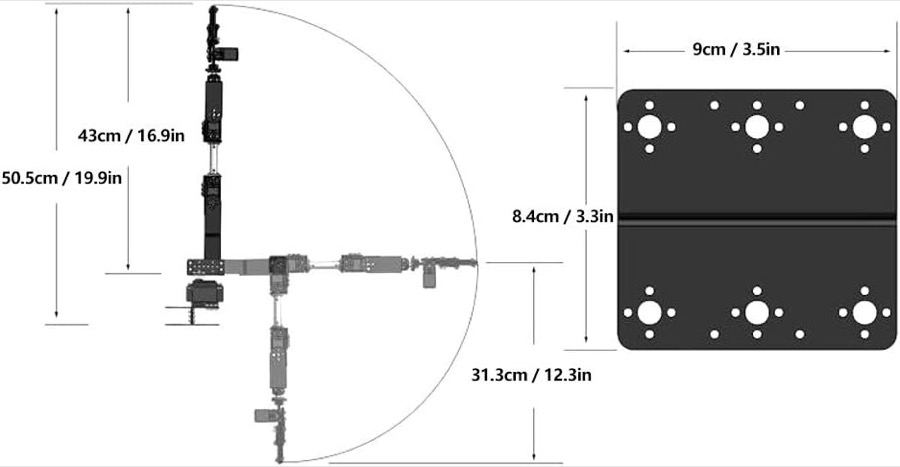

# Product info: Tatiy 6DOF robot arm kit (Amazon)

Source: https://www.amazon.de/dp/B0B4VKYQ6S, read on 2026-10-12.
Images saved from the listing: `images/amazon-dimension-drawing.jpg` and `images/amazon-kit-contents.jpg`.

The listing is a generic Chinese kit listing.
The text is machine-translated, and some fields are filler, such as the age rating.
Treat the numbers as manufacturer claims, not as measurements of our arm.

## 1. Listing basics

| Field | Value |
|-------|-------|
| Title | 6DOF Robot Mechanical Arm Kit, Programmierroboter-Klemmhandklaue mit 6 Servomotoren, 180-Grad-Winkel |
| Brand / manufacturer | Tatiy |
| ASIN | B0B4VKYQ6S |
| Model name in the listing | "Kit de Brazo Mecánico de Robot 6DOF" |
| Price on 2026-10-12 | 79,98 € |
| Rating | 2,6 of 5 stars, 2 ratings, no review texts on the page |
| Colour | Black |
| Country of origin | China |

## 2. Mechanical facts

| Item | Value | Relevance for us |
|------|-------|------------------|
| Degrees of freedom | 6, all driven by servos | Matches S1 to S6 |
| Bracket material | 2 mm aluminium sheet | Thickness for the Blender brackets |
| Joint bearings | Cup bearings ("Schalenlager") at the rotating joints, 3 flange bearings in the kit | |
| Chassis | Disc-shaped turntable for the base rotation | S1 |
| Forearm | One "Flanschstange", the aluminium tube between S3 and S4 | |
| Number of parts | 58 | |
| Weight | 981 g, probably the complete kit | Mass for a physics simulation |

### Manufacturer dimension drawing

| Dimension in the drawing | Value |
|--------------------------|-------|
| Total height, arm pointing straight up | 50,5 cm |
| Shoulder level to the tip, arm pointing straight up | 43 cm |
| Shoulder level to the tip, arm hanging down (folded pose) | 31,3 cm |
| Base plate | 9 x 8,4 cm, with a centre groove and 6 large horn holes |

The drawing also shows the arm stretched out horizontally, with the tip on the same 43 cm arc.
So 43 cm is the maximum reach from the shoulder.
The listing's "Artikelabmessungen 31,3 x 9 x 50,5 cm" are taken from this drawing, not from the package.

## 3. Servo: MG996R

From the listing's specification block:

| Spec | Value |
|------|-------|
| Model | MG996R, analog ("Analoges Lenkgetriebe") |
| Operating voltage | 4,8 to 7,2 V |
| Idle current | 100 mA |
| Torque | 10 kg·cm |
| Rotation range | 180° |
| Cable length | 30 cm |
| Gears | Metal |
| Dead band | 5 µs |

### Typical MG996R datasheet values (not from the listing)

The listing leaves out size, speed and pulse width.
These are the commonly published MG996R values, so check them against a real datasheet before relying on them.

| Spec | Typical value |
|------|---------------|
| Body size | 40,7 x 19,7 x 42,9 mm |
| Weight | 55 g |
| Stall torque | 9,4 kg·cm at 4,8 V, 11 kg·cm at 6 V |
| Speed | 0,17 s per 60° at 4,8 V, 0,14 s per 60° at 6 V |
| Control signal | PWM at 50 Hz, about 500 to 2500 µs pulse for the full range |
| Stall current | about 2,5 A at 6 V |

The body size is useful for the servo boxes in Blender.
The speed gives an upper limit for joint velocity in the simulation.
The stall current matters for the power supply: six servos can draw well over 10 A together.

## 4. Package contents ("Paketliste")

| Qty | Part (listing wording) | Meaning |
|-----|------------------------|---------|
| 6 | MG996 analoges Lenkgetriebe | MG996R servos |
| 6 | Metalllenkrad | Round metal servo horns |
| 1 | Mechanischer Arm | The gripper assembly |
| 1 | Flanschstange | Aluminium tube for the forearm |
| 3 | Flanschlager | Flange bearings |
| 1 | Balken | Beam |
| 1 | Verschiedene U-förmige Halterung | Assorted U brackets |
| 2 | Lange U-Halterung | Long U brackets, the base plates |
| 2 | L-förmige Halterung | L brackets |
| 4 | Multifunktionshalterung | Multi-purpose servo brackets |
| 3 | Verlängerungskabel | Servo extension cables |
| 5 | Packungen Schraubenmuttern | Bags of screws and nuts |
| 1 | Kabelbinder | Cable ties |

The kit photo also shows a spiral cable wrap.
There is no controller board in the kit.
The blue board with the pink edge on our arm was added separately; it looks like a PCA9685 servo driver, but that is not confirmed.

## 5. Comparison with our measurements

| Item | Listing | Our values (`arm-dimensions.md`) |
|------|---------|----------------------------------|
| Shoulder to tip, stretched | 43 | 41,3 with the gripper closed (10,5 + 12,6 + 6,7 + 11,5) |
| Total height, stretched up | 50,5 | 50,9 (9,6 + 41,3), measured from the board top |
| Robot base footprint | 9 x 8,4 | not measured so far |

The total height matches within 0,4 cm.
Our reach is 1,7 cm shorter than the drawing.
The drawing is a rough sketch, so a difference of this size is plausible.

### New conflict: base footprint vs. 1,5 cm edge distance

The base plate is 9 x 8,4 cm.
If S1 sits in the middle of that plate, the axis is at least 4,2 cm from the edge of the plate.
That does not fit an S1 axis only 1,5 cm from the board edge, unless the robot base overhangs the board.
Please check which edge the 1,5 cm refers to.

## 6. Not in the listing

- No link lengths, no gripper opening, no joint limits per axis.
- No wiring diagram, controller or software.
- No pulse-width range for the servos.
