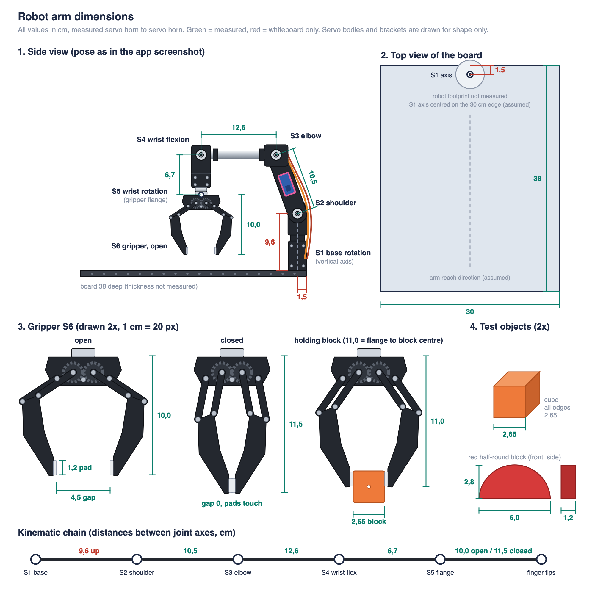

# Robot arm dimensions

Sources, in order of priority:

1. Corrections from the team (link lengths S2 to S3 and S4 to S5, gripper values, block size, edge distance).
2. Photo measurements in `docs/images/` for the arm links: `Full_arm_stretched.png`, `Gripper_open.png`, `Gripper_closed.png`.
3. Whiteboard sketch `docs/images/rough_scretch_robot_setup.jpeg`, only where nothing else exists.

Diagram: `docs/arm-dimensions.svg` (PNG copy: `docs/arm-dimensions.png`).
The side view shows the arm in the pose of the app screenshot `images/screenshot_robot_arm_from_ui.png`.
Regenerate it with `python3 docs/make_arm_dimensions_svg.py`; all values sit at the top of that script.

All values in **cm**, measured from servo horn centre to servo horn centre.
Joint names follow `docs/servo-calibration.md`.

## 1. Measured values

### Board and arm

| Item | Value | Source | What it measures |
|------|-------|--------|------------------|
| Board | 30 x 38 | Whiteboard | Board the robot is mounted on |
| S1 axis to board edge | 1,5 | Team | Back edge of the board to the robot's vertical centre axis |
| Board top to S2 | 9,6 | Whiteboard | Height of the shoulder axis |
| S2 shoulder to S3 elbow | 10,5 | Team | The photo showed 10,0 |
| S3 elbow to S4 wrist flexion | 12,6 | Full_arm_stretched.png | |
| S4 wrist flexion to gripper flange | 6,7 | Team, matches the whiteboard | Includes the S5 wrist rotation servo body. The photo showed 8,6 to a lower point |

S5 wrist rotation turns around the link axis from S4 to the flange.
Its exact position along that axis does not change the kinematics, so the flange is the S5 reference point.

### Gripper (S6)

| State | Flange to finger tips | Gap between the pads |
|-------|-----------------------|----------------------|
| Open | 10,0 | 4,5 |
| Closed | 11,5 | 0, the pads touch |
| Holding the test cube | 11,0 to the cube centre | 2,65 |

| Item | Value |
|------|-------|
| Rubber pads on the finger tips | 1,2 high |

### Test objects

| Object | Colour | Size (width x height x depth) | Shape |
|--------|--------|-------------------------------|-------|
| Test cube | orange | 2,65 x 2,65 x 2,65 | Cube |
| Half-round block | red | 6,0 x 2,8 x 1,2 | Circular segment, flat side down. Arc radius 3,0 |

The arc radius follows from the width and height: (3,0² + 2,8²) / (2 x 2,8) = 3,0.
The shape is just under a full half disc.

Gripping the half-round block: it fits only across its 1,2 depth.
Its 6,0 width is wider than the 4,5 maximum gripper opening.

The fingers get longer as they close, because of the linkage.

## 2. Blender setup

Units: metric scene, 1 unit = 1 m, so divide every value below by 100.

Coordinate system:

- Origin on the top surface of the board, directly under the S1 axis.
- Z points up. Y points from the back edge, where the robot sits, toward the front. X runs along the 30 cm edge.

### Board

| Object | Size X | Size Y | Size Z | Centre (x, y, z) |
|--------|--------|--------|--------|------------------|
| Board | 30 | 38 | t, not measured (use 1,0 as placeholder) | (0, 17,5, -t/2) |

The board centre is 17,5 in front of the S1 axis: half the depth is 19, minus the 1,5 edge distance.

### Joint origins in the straight-up zero pose

All joints stacked vertically above S1. This is a modelling pose, not the servo home position.

| Joint | Name | Origin (x, y, z) | Rotation axis | Distance to next |
|-------|------|------------------|---------------|------------------|
| S1 | Base rotation | (0, 0, 0) | Z (vertical) | 9,6 up |
| S2 | Shoulder | (0, 0, 9,6) | X (pitch) | 10,5 |
| S3 | Elbow | (0, 0, 20,1) | X (pitch) | 12,6 |
| S4 | Wrist flexion | (0, 0, 32,7) | X (pitch) | 6,7 |
| S5 | Wrist rotation, gripper flange | (0, 0, 39,4) | Link axis (roll) | 10,0 open / 11,5 closed |
| Tips | Finger tips, open | (0, 0, 49,4) | | |
| Tips | Finger tips, closed | (0, 0, 50,9) | | |
| Cube | Centre of a held cube | (0, 0, 50,4) | | |

Horizontal reach from the S2 axis with the arm stretched out:

| Up to | Reach |
|-------|-------|
| Finger tips, open | 39,8 |
| Centre of a held cube | 40,8 |
| Finger tips, closed | 41,3 |

Suggested armature: one bone per link, parented in chain order S1, S2, S3, S4, S5, with the gripper as a child of S5.
Lock each bone to its single rotation axis from the table.

### Gripper linkage for modelling (estimated)

The photos show a parallel linkage.
A flange on S5 carries a base plate with two meshing gears.
Each jaw hangs on two parallel links, one on the gear and one on an outer pivot.
The finger therefore moves without turning.
A rubber pad sits on the inner face of each finger tip.

Only the values in section 1 are measured.
The values below were fitted so the linkage reproduces them exactly, and the diagram is drawn with them.
Gripper-local coordinates: u to the side, v down from the flange, in cm.

| Part | Value |
|------|-------|
| Base plate | about 6,4 wide, 2,4 high |
| Gear centres | u = ±0,85, v = 1,4 |
| Outer link pivots | u = ±1,6, v = 1,7 (from the gripper photo; not used by the physics) |
| Link length, both links | 3,5 |
| Pad contact point relative to the gear-link end | 1,52 inward, 6,66 down |
| Pad size | 1,2 high, about 0,27 thick |
| Link angle from vertical: open, holding the cube, closed | 56,4°, 34,7°, 11,0° |

S6 drives the gears, so the S6 servo value maps to this link angle.
The gripper tick range in `servo-calibration.md` is 490 to 650.

## 3. Open questions

- **S1 edge distance vs. base footprint.** The Amazon drawing gives a 9 x 8,4 cm base plate, so a centred S1 axis sits at least 4,2 cm from the plate edge. Which edge does the 1,5 cm refer to? See `amazon-product-info.md`.
- **9,6 shoulder height** comes only from the whiteboard.
- **S1 position along the 30 cm edge** is assumed to be centred.
- **Gripper direction:** does tick value 650 mean open or closed?
- **Not measured:** board thickness, robot base footprint, link widths and servo body sizes.
- **Home pose angles:** to place the model in the servo home position (320 / 427 / 403 / 220 / 480 / 650), we need the joint angle at each home tick value.
