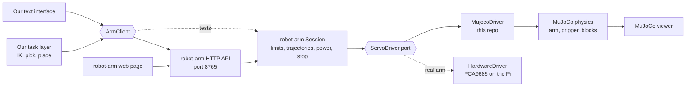

# Simulation concept: MuJoCo sandbox for the 6-servo arm

Status: implemented as described below, with the deviations listed in section 12. See the README for how to run it.
Inputs: `arm-dimensions.md`, `servo-calibration.md`, `amazon-product-info.md`, and the control repo `/Users/jan/projects/robot-arm`.

## 1. Goal

Build a MuJoCo sandbox in which the arm picks a block at a start position and places it at a target position.
The sandbox must be driven through the same interface as the real arm, which is the robot-arm control API.
A command sequence that works in the sandbox should later run unchanged on the real arm, only pointed at a different address.

In scope for the first version:

- The board, the arm with all 6 servos, and the gripper with working grasp physics.
- Four coloured cubes and the red half-round roof block.
- MuJoCo plugged into the robot-arm control stack, so its HTTP API and web page drive the sandbox.
- A text interface to command the arm, and a 3D viewer to watch it.
- Replay of recorded trajectories: robot-arm demo records and our own pose logs.
- A pick-and-place routine for one block, from start to target.
- Images rendered from predefined perspectives, above all the real camera's calibrated view, as visual guidance.
- An automated test suite that proves model, counts, physics, interface, replay, images and task are correct.

Out of scope for now:

- Running the routine on the physical robot. The interface is the same, but real runs need attended commissioning first.
- Camera-based block detection.
- Stacking several blocks. It follows once single pick-and-place is reliable.

## 1.1 Requirements check

Each requirement from the team, and where the concept covers it.

| # | Requirement | Status | Where | Note |
|---|-------------|--------|-------|------|
| R1 | Platform with the arm and its degrees of freedom | Covered | 5, 6.2, 6.3 | Six hinges, gripper as a parallel linkage |
| R2 | The arm follows the servo ticks | Covered | 2, 6.4 | Ticks are PCA9685 counts; the same counts as the real API |
| R3 | A text interface to address the arm | Covered | 6.7 | Speaks the robot-arm HTTP API, so it also drives the real arm |
| R4 | We must see it | Covered | 6.8 | MuJoCo viewer, plus robot-arm's own web page against the sandbox |
| R5 | Physics to grasp the blocks | Covered | 6.3, 7 | Pads with friction, grasp and rest tests |
| R6 | Four blocks in four colours and the roof block | Covered | 5 | Colours still to be confirmed |
| R7 | Move a block from a start to a target position | Covered | 6.6 | Needs `move_pose` or the single-joint fallback |
| R8 | Tests that prove it works | Covered | 7 | Added replay and image tests |
| R9 | Simulate recorded trajectories | Added | 6.9 | Was a gap: demo records are scope-locked, see 6.9 |
| R10 | Record images from a predefined perspective as visual guidance | Added | 6.10 | Was a gap: the sandbox renders the real camera's calibrated view |
| R11 | Matches the physical robot, ideally 1:1 | Partly | 2, 3, 10, 11 | Same API and counts; accuracy depends on the open calibration inputs in section 10 |

## 2. What the robot-arm repo provides

The robot-arm repo is the API for the real arm. Its relevant facts:

| Topic | Fact | Source in robot-arm |
|-------|------|---------------------|
| Command unit | Integer PCA9685 counts at nominal 60 Hz, called counts, not degrees. Our "ticks" are these counts. | `docs/api.md` |
| Channels | Servos S1 to S6 are channels 0 to 5 | `README.md` |
| Driver port | `ServoDriver` with `scope`, `prepare()`, `write(channel, count)`, `disable(channel)`, `verify_off()`, `close()` | `control/domain/ports.py` |
| Application service | `Session` owns validation, limits, motion, demos, stop and power on/off | `control/application/session.py` |
| HTTP API | FastAPI on port 8765: `power_on`, `power_off`, `stop`, `move`, `jog`, `go_pose`, `settings`, `limits`, demo actions, `GET /api/state` | `control/presentation/http_api.py` |
| Composition | `session_for(driver, channels, …)` plus `Server(session, port)`; any object that fulfils `ServoDriver` can be plugged in | `http_api.py` |
| Outer bounds | S1 90–660, S2 185–660, S3 to S5 90–660, S6 490–660 | `shared/joints.py` |
| Poses | HOME 320/427/403/220/480/650, PARK 330/540/580/195/480/650 | `session.py`, `config/reference-arm/` |
| Motion | Smoothstep trajectory, duration 1,5 × distance / speed, a new command every 20 ms, rounded to integer counts | `domain/motion.py`, `application/motion_runner.py` |
| Speed | Manual moves and HOME/PARK at 20 counts/s, demo playback 1 to 100 counts/s | `session.py` |
| Power on | Requires the operator to confirm PARK, then enables PARK and moves to HOME | `session.py` |
| Stop | Cancels motion and disables all outputs; commands become unknown | `session.py` |
| Feedback | None. The API reports commanded counts, never measured positions | `docs/api.md` |
| Browser 3D view | `/simulation` draws the commanded counts with a visual model, without physics | `web/simulation.js` |
| Table frame | Camera calibration maps pixels to a table frame in mm: origin at the midpoint of the edge nearest the arm, +X away from the arm, +Y to the left seen from the arm, printed area 360 × 280 mm | `docs/camera-table-xy-calibration.md` |
| Demo records | JSON with a name and positions, each a name plus six counts; scope `synthetic` or `commissioning`; a store refuses records of the other scope | `control/infrastructure/demo_store.py` |
| Demo playback | `demo/load` then `demo/run` or `demo/next`; each position is one trajectory at the demo speed | `session.py` |
| Camera port | `CameraSource` with `kind`, `open()`, `apply(changes)`, `read()` returning a JPEG sample, `close()`; `CameraService(session, source)` serves `/api/camera/…` | `control/domain/camera.py`, `application/camera.py` |
| Camera view | The reference images show the OAK camera at the far table edge, raised, looking back toward the arm; 1280 × 720 after crop and undistortion | `config/camera-table-xy/rgb-1.png` |

Three consequences for the sandbox:

- **The counts are confirmed.** At 60 Hz one count is about 4,07 µs of pulse width. The MG996R travel of roughly 500 to 2500 µs is then about 123 to 614 counts, or about 2,7 counts per degree. Our measured slopes of 2,4 to 3,1 counts per degree fit this.
- **The table frame is our board.** The printed area of 360 × 280 mm matches the 38 × 30 cm board within the paper margin. The sandbox adopts this frame, so camera coordinates can be used directly.
- **The base position needs a second look.** In the calibration image the base plate stands on the printed area, between the near edge and roughly the X = 70 mm line. The S1 axis is then about 40 mm inside the near edge, not 15 mm outside it. See section 10.

## 3. Integration decision

MuJoCo becomes a new `ServoDriver` behind the existing `Session`.
The sandbox therefore uses the real application service, the real validation, the real trajectories and the real HTTP API.
Nothing above the driver is duplicated.



| Mode | Server | Driver | Client address |
|------|--------|--------|----------------|
| Sandbox | Our launcher composes robot-arm's `Session` and `Server` | `MujocoDriver` | `http://127.0.0.1:8765` |
| Real arm | robot-arm app on the Pi | `HardwareDriver` | `http://raspberrypi.local:8765` |
| Tests | No HTTP, `Session` in the same process | `MujocoDriver` with simulated time | in-process client |

This needs no change in the robot-arm repo.
Our launcher imports its modules and passes our driver to `session_for`.

## 4. Gaps in the API and proposed extensions

| Gap | Effect | Proposal |
|-----|--------|----------|
| `move` moves one joint at a time. Several joints move together only for HOME, PARK and recorded demo positions. | Pick and place needs coordinated poses, for example lowering S2, S3 and S4 together. | Add a `move_pose` action to robot-arm: six target counts, validated with the existing batch check and run by the existing motion runner. This follows the extension path in robot-arm's `architecture.md`. Until it exists, the client falls back to single-joint moves in a safe order. |
| Manual moves are fixed at 20 counts/s. | One pick-and-place cycle with single-joint moves takes about two minutes. | Let `move_pose` use the demo speed setting of up to 100 counts/s. |
| Demos record only the current commands; arbitrary positions cannot be uploaded. | A planned sequence cannot be sent as a demo. | Not needed once `move_pose` exists. |
| The server knows nothing about blocks. | Pick and place targets need block positions. | The sandbox exposes block positions through its own sim-only routes, under `/sim/`, added by our launcher. On the real arm they later come from the camera. |

`move_pose` is the only change we would propose to robot-arm.
It is a pull request to that repo, kept separate from this sandbox.

## 5. Scene setup

The scene uses robot-arm's table frame, in millimetres, so camera coordinates can later be used directly.

| Element | Definition |
|---------|------------|
| Table | 380 × 300 mm board, origin at the midpoint of the edge nearest the arm, +X away from the arm, +Y left |
| Arm | Base axis (S1) on the centre line Y = 0; X between −15 (team value) and about +40 (calibration image), to be confirmed; joint chain from `arm-dimensions.md` |
| Camera | The real OAK camera pose, fitted from the calibration record, see 6.10 |
| Cubes | 4 cubes of 26,5 mm in red, green, blue and yellow; the same names as robot-arm's browser simulation |
| Roof block | Red half-round block, 60 × 28 × 12 mm, flat side down |
| Slots | Named start and target positions in `scene.yaml`, for example `A1` to `A4` and `T1` to `T4` |

Every slot must be reachable with a top-down grasp.
The roof block can only be gripped across its 12 mm depth, so its slot also fixes its yaw.

## 6. Components

### 6.1 Configuration as the single source of truth

Two YAML files hold every number; nothing is hard-coded.

- `config/robot.yaml`: link lengths, gripper geometry, masses, and the count-to-angle calibration per channel.
- `config/scene.yaml`: table, base position, blocks, slots, friction and other physics parameters.

Channel bounds, HOME and PARK are not copied. They are read from robot-arm at start-up, so the sandbox can never accept a command the real `Session` would refuse.

### 6.2 MuJoCo model

A Python builder generates the MuJoCo model from the two YAML files.

| Channel | Joint | MuJoCo joint |
|---------|-------|--------------|
| 0 | S1 base rotation | hinge, vertical axis |
| 1 | S2 shoulder | hinge, pitch |
| 2 | S3 elbow | hinge, pitch |
| 3 | S4 wrist flexion | hinge, pitch |
| 4 | S5 wrist rotation | hinge, link axis |
| 5 | S6 gripper | hinge on the gear link, see 6.3 |

Links start as boxes and cylinders with the measured lengths.
Servo bodies use the MG996R size of 40,7 × 19,7 × 42,9 mm and 55 g.
Better meshes can replace them later without changing the joints.

### 6.3 Gripper

The real gripper is a parallel linkage, so each finger moves on an arc without turning.
The model uses a hinge on each gear link and a hinge between link and finger.
An equality constraint keeps the finger at minus the link angle, so it stays parallel.
A second constraint mirrors the left jaw to the right jaw, so channel 5 drives both.
The geometry uses the fitted values in `arm-dimensions.md`.
The rubber pads are separate collision boxes, 12 mm high, with high friction.

### 6.4 MujocoDriver

`MujocoDriver` implements robot-arm's `ServoDriver` port with scope `synthetic`.

| Port method | Sandbox behaviour |
|-------------|-------------------|
| `prepare()` | Sets all outputs to off; does not reset the scene |
| `write(channel, count)` | Converts the count to a joint angle and sets it as the position actuator target |
| `disable(channel)` | Switches that actuator off, so the joint goes limp like a servo without a signal |
| `verify_off()` | Fails if any output is still on |
| `close()` | Stops the physics thread |

Count to angle per channel:

```
angle = direction * (count - reference_count) / counts_per_degree + reference_angle
```

- `counts_per_degree` comes from the measured 90° moves, for example 220 / 90 = 2,44 for channel 1.
- The reference is the HOME pose, as in robot-arm's browser model. `reference_angle` is the joint angle in HOME, which still has to be measured.
- `direction` starts with the signs in robot-arm's `web/simulation.js` and is confirmed on the real arm. That model also assumes the gripper opens towards 490 and closes towards 660.

The servo is modelled as a stiff position actuator, limited to the MG996R torque of about 1 N·m.
The commanded speed of 20 to 100 counts/s is far below the MG996R's own top speed, so the servo follows the command closely.
Backlash, dead band and sag are optional switches, off by default.

Timing:

- **Sandbox server:** a physics thread steps MuJoCo in real time. `write()` only updates the target, guarded by a lock.
- **Tests:** `Session` accepts its own `clock` and `sleep`. The tests pass a simulated clock whose `sleep` advances the physics. Runs are then deterministic and faster than real time.

At start the arm stands at the PARK counts, because `power_on` requires the arm to be in PARK.

### 6.5 Clients

One small `ArmClient` interface mirrors the API actions: `state`, `power_on`, `power_off`, `stop`, `move`, `jog`, `go_pose`, `settings`, `move_pose` and `wait_idle`.

- `HttpArmClient` speaks the HTTP API. It sends the `Origin` and `Content-Type` headers the API requires, and waits for completion by polling `busy` in `/api/state`. The same client serves the sandbox and the real arm.
- `SessionArmClient` calls `Session` directly, for tests without HTTP.

If the server has no `move_pose`, the client executes a pose as single-joint moves in a safe order: first lift, then turn the base, then lower.

### 6.6 Kinematics and task layer

After S1 turns towards the target, S2, S3 and S4 form a planar arm.
With the gripper pointing straight down, the wrist position follows from a closed-form two-link solution.
S5 turns the gripper to match the block's yaw.
The result is converted to counts, so the task layer outputs counts only.

Pick and place sequence:

1. Open the gripper and move above the block, 50 mm higher.
2. Descend to grasp height.
3. Close the gripper until it holds the block.
4. Lift back to the safe height.
5. Move above the target slot.
6. Descend, open the gripper, lift again.
7. Return to HOME.

Each step is a full six-count pose and is logged.
The log is the replay format for the real arm.

### 6.7 Text interface

An interactive command line using the API's terms.
`--target` selects the sandbox or a real arm address.

| Command | API action |
|---------|------------|
| `power on`, `power off`, `stop` | `power_on`, `power_off`, `stop` |
| `move S2 450` | `move` on channel 1 |
| `jog S3 +` | `jog` on channel 2 |
| `home`, `park` | `go_pose` |
| `pose 320 427 403 220 480 650` | `move_pose`, or single-joint moves as fallback |
| `speed 20` | `settings` |
| `state` | `GET /api/state` |
| `pick red`, `place T2` | Task layer, which issues poses |
| `demo import FILE`, `demo load NAME`, `demo run`, `demo next`, `demo pause` | Demo actions, see 6.9 |
| `snapshot [CAMERA] [FILE]` | Renders one image, see 6.10 |
| `blocks`, `reset` | Sandbox only, `/sim/` routes |
| `run FILE` | Runs a script of these commands, or replays a pose log |

Against a real arm, `power on` asks the operator to confirm PARK and support, as robot-arm's safety rules require.

### 6.8 Viewer

The MuJoCo viewer runs in passive mode next to the server, so the API keeps control.
Preset cameras give a front view, a side view like the app screenshot, and a top view.
robot-arm's own web page and `/simulation` keep working against the sandbox server, because they only read `/api/state`.

### 6.9 Replay of recorded trajectories

Two kinds of recordings exist, and both must play in the sandbox.

**robot-arm demo records.** These are the trajectories recorded on the real arm with Demo add and Demo save.
They play through robot-arm's own demo playback, so the sandbox moves exactly as the real arm would: the same smoothstep trajectory per position, the same demo speed, the same validation.

The obstacle is scope.
A record saved on the hardware carries scope `commissioning`, and the sandbox session runs with scope `synthetic`, so `demo/load` refuses it.
robot-arm does this on purpose, to keep synthetic records away from the hardware.
The reverse direction is harmless, so the sandbox gets an import step:

1. `demo import FILE` reads the commissioning record, checks that every position is inside robot-arm's bounds, and writes a copy into the sandbox's synthetic demo directory with the scope field rewritten and a provenance note naming the source file.
2. `demo load`, `demo run`, `demo next` and `demo pause` then map to the API's demo actions.
3. State polling shows the demo cursor, so the text interface reports which position is playing.

Records never flow the other way. A demo recorded in the sandbox stays synthetic and cannot be loaded on the hardware, by robot-arm's design.

**Our own pose logs.** The task layer and the text interface log every pose as six counts with a timestamp, speed and label.
`run FILE` replays such a log through `move_pose` or the single-joint fallback.
The same log file is what an operator later replays on the real arm, with `--target` pointed at the Pi.

A replay can run in real time with the viewer, or with simulated time in tests.
Replay against the sandbox also answers a practical question: whether a demo recorded by hand ever hits a block or the table, which the real arm cannot tell.

### 6.10 Images from predefined perspectives

The sandbox renders images with MuJoCo's offscreen renderer, at 1280 × 720 like the real camera.
Perspectives are named cameras in `scene.yaml`:

| Camera | Pose | Use |
|--------|------|-----|
| `oak` | The real camera's pose, fitted to the calibration record | Visual guidance that matches what the real camera sees |
| `top` | Straight down over the table centre | Checking block positions |
| `side` | The app screenshot's view | Checking heights and the grasp |
| `front` | From the far edge at table height | Checking the approach |

**Fitting the `oak` camera.** The calibration record holds a homography from image pixels to table coordinates, the exact marker layout, and the detected marker corners in five frames.
It does not hold the camera's position or its intrinsics.
The sandbox therefore fits the camera pose and vertical field of view so that the six marker centres project to the same pixels as in the record.
The fit is checked with the same grid points the calibration used; the target is a projection error below 3 pixels.
The field of view is read from the OAK-D Lite specification and confirmed by the fit.

**Capture.** There are two ways to take an image:

- `snapshot [CAMERA] [FILE]` in the text interface saves one PNG.
- The task layer captures automatically at each pick-and-place step, with the step label and the six counts in the file name and in a JSON sidecar, so a sequence of images documents a run.

An optional overlay draws the grasp point, the target slot and the commanded counts on the image.
Overlays are off by default, so plain images stay comparable with real captures.

**Same routes as the real camera.** The renderer also implements robot-arm's `CameraSource` port, with kind `mujoco`.
Our launcher passes it to `CameraService`, so the sandbox serves `/api/camera/status`, `/api/camera/snapshot.jpg`, `/api/camera/stream.mjpg` and `/api/camera/capture` exactly like the Pi.
Depth stays null, as robot-arm allows for a source without depth.
A client that reads guidance images from the camera route therefore needs no change between sandbox and real arm.

**What the images are for.** A person or an agent compares the rendered view with the real camera's view at the same counts.
Matching images confirm the calibration; a mismatch points at a wrong link length, reference angle or direction.
Later, the same route can feed block detection, which then runs identically on rendered and real images.

## 7. Test strategy

Tests use pytest, run without a window, and use the in-process client and simulated time unless stated otherwise.

| Level | What is tested | Pass criterion |
|-------|----------------|----------------|
| Configuration | `robot.yaml` matches `arm-dimensions.md` | Every length equal to the documented value |
| Model | Model compiles; joint positions in the straight-up pose | S5 flange at 394 mm and tips at 494 / 509 mm, within 1 mm |
| Gripper geometry | Open and closed states | Gap 45 / 0 mm, flange to tips 100 / 115 mm, within 1 mm |
| Calibration | Counts to angle and back; the measured 90° moves | Round trip exact; 90° moves within 0,5° |
| Driver contract | `MujocoDriver` under robot-arm's `Session`: prepare, write, disable, verify_off, close, stop | Same observable behaviour as robot-arm's `PreviewDriver` for the same actions |
| Bounds | Commands outside robot-arm's bounds | Refused by `Session`, nothing reaches the driver |
| Limp on stop | `stop` while the arm holds a pose | Actuators off, arm sags under gravity |
| Kinematics | IK followed by FK for a grid of reachable points | Tip within 1 mm of the target; unreachable points rejected |
| Physics at rest | Blocks and a stack of 4 cubes left alone for 5 s | Drift below 1 mm, nothing falls |
| Grasp | Pick a cube, lift it, swing the arm | Block slips less than 2 mm relative to the gripper |
| Task | Pick each block from its start slot, place it at its target | Final position within 5 mm and 10° yaw, block upright, other blocks untouched |
| Roof block | Pick and place across the 12 mm depth | Same criteria as the task test |
| Demo import | A commissioning record from `robot-arm/config` or a fixture, imported and loaded | Positions identical; a record with a count outside the bounds is refused |
| Demo replay | A recorded demo played through the API's demo actions | Every position reached in order; cursor and status in `/api/state` match; final counts equal the last position |
| Pose log replay | A task run logged, then replayed from the log | Same final block position within 1 mm |
| Camera fit | The `oak` camera projects the calibration markers | Projection error below 3 pixels for all six markers |
| Rendering | Snapshot from each named camera | 1280 × 720 image; the pixel at a known block position has that block's colour |
| Camera routes | `/api/camera/snapshot.jpg` and `/capture` on the sandbox server | Valid JPEG, metadata with run ID and sequence, depth null |
| HTTP end to end | Sandbox server on a free port, `HttpArmClient`, one full task | Same final state as the in-process run |
| Fallback | Task with single-joint moves instead of `move_pose` | Task succeeds |
| Text interface | Scripted command session | Command log equals a stored reference log |
| Determinism | Same script twice | Identical final state |
| Robustness | Task with random count offsets of up to ±5 counts per channel | Task still succeeds, which shows the margin for the real arm |

## 8. Project layout and tools

```
px-robotoc-arm-sim/
  config/robot.yaml, config/scene.yaml
  armsim/
    model_builder.py   MuJoCo model from the config
    calibration.py     counts <-> joint angles
    driver.py          MujocoDriver, implements robot-arm's ServoDriver
    physics.py         physics thread, simulated clock for tests
    server.py          launcher: robot-arm Session and Server with MujocoDriver, plus /sim/ routes
    client.py          ArmClient, HttpArmClient, SessionArmClient
    kinematics.py      forward and inverse kinematics
    tasks.py           pick and place
    replay.py          demo import and pose log replay
    cameras.py         named cameras, offscreen rendering, CameraSource for robot-arm
    cli.py             text interface
    viewer.py          viewer and camera presets
  scripts/             example command scripts
  tests/
  docs/
```

Tools: Python 3.12 or newer and uv, as in robot-arm; `mujoco` 3.x, `numpy`, `pyyaml`, `pytest`.

robot-arm is not an installable package (`package = false`); its scripts put `src/` on the import path.
The sandbox does the same, with the robot-arm checkout location set by `ROBOT_ARM_PATH`, defaulting to `../robot-arm`.
The tested robot-arm commit is recorded, so an API change there is noticed.

## 9. Milestones

| Step | Result | Done when |
|------|--------|-----------|
| M1 | `MujocoDriver` under robot-arm's `Session`; the arm moves through the web page, the API and the text interface; viewer works | Model, calibration, driver contract and bounds tests pass |
| M2 | Gripper physics and blocks; manual pick by single commands | Grasp and rest tests pass |
| M2b | Demo import and replay; pose log replay | Replay tests pass; a demo recorded on the real arm plays in the sandbox |
| M3 | IK and the `pick` / `place` commands, with the single-joint fallback | Kinematics and task tests pass for all four cubes |
| M3b | Named cameras, the fitted `oak` view, snapshots, camera routes | Camera fit, rendering and camera route tests pass |
| M4 | `move_pose` proposed to robot-arm; roof block; HTTP end-to-end and robustness tests | Full test suite passes |
| M5 (later) | Attended run of the same script on the real arm | Matching poses in sandbox and real arm |

## 10. Decisions and inputs needed

| Topic | Question |
|-------|----------|
| `move_pose` | Do we propose this action to robot-arm, or stay with single-joint moves? |
| Reference angles | What is each joint's angle in the HOME pose? Without it the sandbox cannot place the arm correctly. |
| Directions | Are the signs in robot-arm's `web/simulation.js` right for the real arm, including the gripper opening towards 490? |
| Base position | The team value puts the S1 axis 15 mm from the edge; the calibration image shows the base plate on the printed area with the axis about 40 mm inside the near edge. Which edge is meant, and is the printed sheet still at the same place? |
| Recorded demos | Which demo records should play in the sandbox? Please provide the JSON files from the Pi's `artifacts/demos/commissioning/`. |
| Camera | Is the camera still mounted as in the calibration images? Its field of view would also help the fit; the OAK-D Lite RGB value is about 69° horizontal before cropping. |
| Guidance images | Who consumes them: a person, an agent, or both? That decides whether overlays and a JSON sidecar are needed from the start. |
| Blocks | Material and therefore mass, and the start and target slots. The colours follow robot-arm's browser simulation unless you prefer others. |
| Roof block | Is it only moved like the cubes, or does it go on top of a stack later? |

## 11. Known limits

- The real servos have no position feedback. The sandbox shows what the commands should do, not what the real arm does under load.
- Accuracy depends on calibration. A 1° error at the shoulder moves the tip by about 7 mm at full reach.
- The gripper geometry is fitted to measurements, not taken from a drawing. The grasp is reliable in the sandbox only as far as these values are right.
- The sandbox uses robot-arm's `synthetic` scope. Poses and demos saved in the sandbox cannot be loaded on the hardware, by robot-arm's design. Command logs in counts carry over instead.

## 12. Implementation notes (2026-10-12)

What was built follows sections 3 to 8. Deviations and decisions made during the build:

- **`move_pose` exists in the sandbox.** `armsim/session.py` subclasses robot-arm's `Session` and adds it; the launcher registers `POST /api/move_pose`. The client still falls back to single-joint moves when a server lacks the route, so the same text interface works against the Pi today.
- **The gripper jaws open in the arm plane** at S5 = 480 (`gripper.pads_axis: x`), as in every photo of the arm. The axis is a config switch; `y` opens them across the arm plane.
- **S4's HOME angle is assumed 105°, not 90°.** With 90° the PARK pose pressed the pads into the table and the servos jammed the arm against table friction, exactly as real servos would. With 105° the lowest pad of the tilted PARK gripper rests on the base plate; the plate's top is derived from that pad height in the model builder (`rest_height`).
- **A three.js view** (`web/arm3d.html`) draws the arm from primitives to look like the kit and follows the same API; without an API it runs standalone with sliders and its own minimal block physics (`web/arm3d-core.js`, tested with node). Against the sandbox it shows the MuJoCo block positions.
- **Base position 40 mm inside the near edge**, from the calibration image, as the single number `base.x` in `scene.yaml`.
- **Slot layout:** slots stay out of the corridor the arm sweeps during PARK/HOME transitions and at least 50 mm apart, because the open gripper spans about 62 mm over the fingers.
- **The task layer lifts before it travels.** HOME is low (the pad bottoms about 22 mm above the table), so every pick and the return to HOME go through a waypoint at travel height.
- **Rendering runs on one dedicated thread.** macOS allows the offscreen GL context only on the thread that created it, so all renders go through a worker thread; robot-arm's camera service and the snapshot route both use it.
- **Camera fit:** the real camera is fitted from robot-arm's calibration record with 2,9 px RMS over the six markers; it stands about 52 cm from the arm at 31 cm height, looking back at the arm.
- **The real HC-SR04 and OAK hardware routes** are untouched: distance stays disabled, the camera service is fed by the renderer.

Test suite: 63 tests, about two minutes, including an HTTP end-to-end run of a pick and place through the text interface and a demo import and playback.
