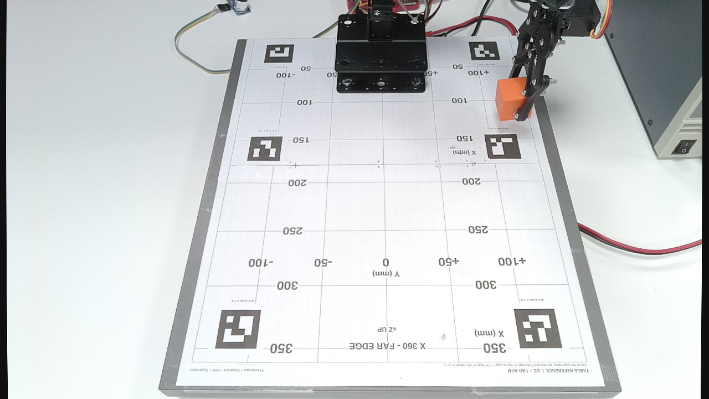

# Live controller, read on 2026-10-12

Controller app: http://10.102.4.103:8765/ (team network), Swagger docs at `/docs`.
It runs the software from `lutich/robot-arm`, see `reference-robot-arm-repo.md`.

Read at about 13:14 UTC with GET requests only (`/api/state`, `/api/camera/status`, `/api/camera/snapshot.jpg`, `/api/distance/status`, `/openapi.json`).
Nothing was sent to the arm.
At that time the app was in **hardware mode, armed, outputs on**, and the gripper was holding the orange cube.

## 1. Camera view

`images/photos/controller-camera-2026-10-12.jpg`: one RGB frame from `/api/camera/snapshot.jpg`, 1280 x 720, captured 2026-10-12 13:14:19 UTC.

| Setting | Value |
|---------|-------|
| Camera | OAK, RGB plus stereo depth aligned to RGB, both 1280 x 720 at 5 fps |
| Exposure | Manual, 30000 µs, ISO 200 (the calibration record used ISO 430) |
| White balance | Manual, 4000 K |
| Focus | Manual, lens position 65, same as the calibration |
| Depth | About 56 % valid pixels in this frame |

How to read the image:

- The camera sits at the **far end** of the mat and looks back toward the arm. The mat's labels therefore appear upside down.
- Image top = the mat edge nearest the arm (camera-frame X = 0). Image bottom = far edge (X = 360 mm).
- Image right = +Y (left as seen from the arm). Image left = -Y.
- The arm base sits at the top centre, on the mat, covering roughly X = 0 to 85 mm.
- In this frame the gripper holds the orange cube at roughly X = 130 mm, Y = +110 mm, read by eye from the grid.

That gives a first guess for the offset `d` in `reference-robot-arm-repo.md` (S1 axis to the mat's near edge): a few centimetres, with the S1 axis about 4 cm from the mat edge if the base plate is centred on it.
This is read from the photo and still has to be measured.

## 2. What the UI offers

Panels on the page: Initialize (Power on), Joint control (Move, jog, Min/Max, Step size, Go HOME, Go PARK, Save HOME, Save PARK), Recorded Demo (Add position, Next step, Run all once, Save, Load), Camera (View, Capture, Download RGB, Download depth PNG, Focus once, exposure, ISO, white balance, lens position), and Distance (Measure, samples) for the HC-SR04 sensor.

API routes from `/openapi.json`:

| Read only (GET) | Changes state or moves (POST) |
|-----------------|-------------------------------|
| `state`, `camera/status`, `camera/snapshot.jpg`, `camera/capture`, `camera/stream.mjpg`, `camera/depth/snapshot.png`, `camera/depth/preview.png`, `camera/depth/stream`, `distance/status`, `distance/read` | `stop`, `power_on`, `power_off`, `prepare`, `arm`, `move`, `jog`, `go_pose`, `limits`, `settings`, `save`, `camera/settings`, `demo/*` |

`distance/read` is a GET but fires the ultrasonic sensor; it does not move the arm.

## 3. Live poses

### HOME has changed

| Pose | S1 | S2 | S3 | S4 | S5 | S6 |
|------|----|----|----|----|----|----|
| HOME, live on 2026-10-12 | 320 | 427 | 403 | 220 | **250** | **550** |
| HOME in `servo-calibration.md` and the repo's `home.json` | 320 | 427 | 403 | 220 | 480 | 650 |
| PARK, live | 330 | 540 | 580 | 195 | 480 | 650 |

S5 (wrist rotation) and S6 (gripper) in HOME differ from our docs.
S5 = 250 is the start of the measured 90° move (250 to 480) in `servo-calibration.md`, so HOME now sits 90° away from the old wrist rotation.
Before using the "calibrated start" assumption, the team has to agree which HOME is the reference.

### Hand-taught pick and place

The demo draft loaded in the app, `step1-hacks-10-direct-approach`, is a taught pick and place of the orange cube:

| # | Position | S1 | S2 | S3 | S4 | S5 | S6 |
|---|----------|----|----|----|----|----|----|
| 1 | HOME start | 320 | 427 | 403 | 220 | 250 | 550 |
| 2 | Above orange, open | 440 | 427 | 360 | 185 | 340 | 490 |
| 3 | Single approach, open | 440 | 347 | 360 | 185 | 340 | 490 |
| 4 | Close gripper | 440 | 347 | 360 | 185 | 340 | 590 |
| 5 | Lift cube | 440 | 427 | 360 | 185 | 340 | 590 |
| 6 | Transfer | 230 | 427 | 360 | 185 | 340 | 590 |
| 7 | Lower to destination | 235 | 347 | 360 | 185 | 380 | 590 |
| 8 | Release cube | 235 | 347 | 360 | 185 | 380 | 490 |
| 9 | Withdraw | 235 | 407 | 360 | 185 | 380 | 490 |
| 10 | HOME finish | 320 | 427 | 403 | 220 | 250 | 550 |

Other saved demos on the controller: `demo-2-cubes` (16 positions), `Hackaton` (13 and 16), `step1-hacks` (15), `step1-hacks-11-draft` (11), `Test 1` (5), `placement-clear-hover` (1), `HOME with held cube — S6 unchanged` (1).
They were not loaded, because loading replaces the draft the team is working on.

What this tells us:

- **Gripper direction is answered:** 490 = open, 590 = closed on the cube, 650 = fully closed. Higher counts close the gripper.
- The taught approach lowers the cube by moving **only S2** (427 to 347), with S3 and S4 fixed. The gripper therefore moves on an arc, not straight down. The IK in `pick-and-place-plan.md` moves S2, S3 and S4 together for a vertical descent.
- S1 turns 205 counts between pick (440) and place (235), about 67° at 3,06 counts per degree.
- These poses are real data points: once a cube position is measured for each, they can check the IK and help find the joint angles at HOME.
