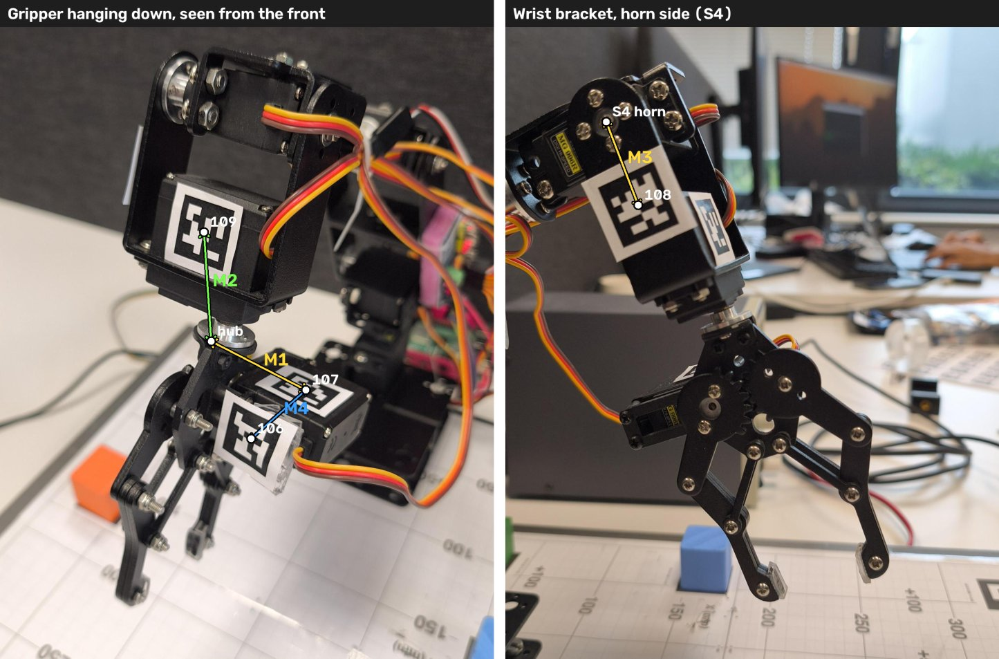

# What to measure on the arm (tags and S5 hub)

The cameras already measure the tags well relative to each other, and the joint fit finds the S5 axis. One thing they cannot see: **how far along the S5 axis the gripper's tags sit relative to the flange** (the point the gripper turns about). Turning S5 looks the same whether the gripper tags sit higher or lower on that axis. These measurements pin it down and check the rest.

## Before you start

- **Arm:** leave it where it is, nothing needs to move. It is easiest with the gripper hanging straight down (as in the left photo).
- **Tools:** a caliper is best, a ruler with millimetres is fine. Give every value in **mm**.
- **Tag centre:** the point where the diagonals of the **black square** cross. The white margin does not count.
- **Hub:** the round aluminium coupling directly under the wrist servo (S5), where the gripper is screwed on. It turns with S5; its centre line is the S5 axis. Measure to the centre of its **lower face**, where the gripper's black bracket starts.
- **S4 horn:** the round black horn with four screws around one centre screw, on the side plate of the wrist bracket (right photo). Its centre screw is on the S4 axis.

## The measurements

| | From → to | How | Model now (mm) |
|--|-----------|-----|----------------|
| **M1** (most important) | hub → centre of tag **107** (on top of the gripper servo, facing up toward the wrist) | Two numbers: **along** the S5 axis (height difference, vertical when the gripper hangs down) and **sideways** (horizontal distance from the axis). Add the direction: tag 107 is to the left/right of the hub and nearer/further than it, seen from the front as in the photo | along 15, sideways 31 (photos 2026-10-13) |
| **M2** | centre of tag **109** (on the wrist servo's face) → hub | **Along** (height difference) and **sideways** (horizontal offset of the tag centre from the axis, left or right seen from the front) | along 27, sideways 13 |
| **M3** | centre of the S4 horn's middle screw → centre of tag **108** (on the side plate) | Straight distance on the plate | 25 |
| **M4** | centre of tag **107** → centre of tag **106** (on the gripper servo's cable end) | Straight distance (a check: the cameras give 28 to 29) | 29 |
| **M5** | each tag (106, 107, 108, 109) | Side of the black square | 19 |

If you only have time for one: **M1**.

## What happens with the numbers

Tell me the values, or enter them in `threejs-sim/js/config.js` `ARM_TAGS`:
- **M1** sets tag 107's (and with it 106's) height in the gripper frame. That fixes the along-axis question.
- **M2** checks tag 109's height in the wrist frame.
- **M3** checks 108.
- **M5** sets `size`.

After that, "Record pose" and "Fit S5 axis" (Camera tab, Arm tracking) only need to refine the rest. The S6 servo and the tags 106/107 were placed from the photos `arm-tags-106-107-109-front-s6-right*.jpg` on 2026-10-13 (about 2 mm); M1 checks that.
